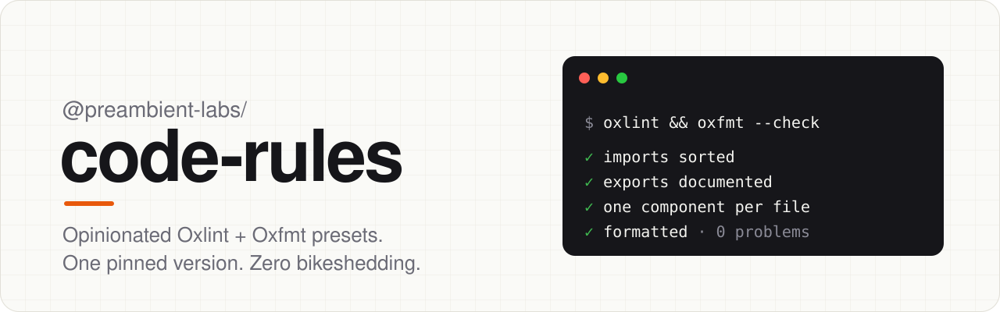

<div align="center">

<picture>
  <source media="(prefers-color-scheme: dark)" srcset=".github/assets/banner-dark.svg">
  
</picture>

<br>

[](https://github.com/preambient/code-rules/actions/workflows/ci.yml)
[](https://www.npmjs.com/package/@preambient-labs/code-rules)
[](LICENSE)
[](https://oxc.rs/docs/guide/usage/linter)
[](https://oxc.rs/docs/guide/usage/formatter)

**Strict, versioned lint and format presets for TypeScript and React. Built on [Oxc](https://oxc.rs).**<br>
Install one exact version and import one preset. Every repository then follows the same rules.

[Quick start](#-quick-start) · [Presets](#-presets) · [Rules](#-rules-at-a-glance) · [Contributing](#-contributing)

</div>

---

## ✨ Why

- **Fast.** Oxlint and Oxfmt run in Rust. Perfectionist, Stylistic, and JSDoc run _inside_ Oxlint's JS plugin API, so you don't need a separate ESLint step.
- **Opinionated.** Everything is sorted alphabetically, declarations get blank lines around them, exported functions get JSDoc, imports are extensionless, and there's one React component per file.
- **Pinned.** Every tool and plugin version is locked. A policy change is a new release, so upgrades are a one-line diff you can review.
- **Safe fixes only.** `--fix` applies only rewrites that can't change behavior. A change that could reorder evaluation is offered as an editor suggestion instead.

## 🚀 Quick start

**1. Install an exact version**, along with the matching tool versions:

```bash
bun add --dev --exact @preambient-labs/code-rules@0.11.0 oxlint@1.86.0 oxfmt@0.72.0
```

**2. Pick a preset:**

```ts
// oxlint.config.ts
export { default } from "@preambient-labs/code-rules/frontend";
```

```ts
// oxfmt.config.ts
export { default } from "@preambient-labs/code-rules/oxfmt";
```

**3. Add the scripts:**

```json
{
  "scripts": {
    "lint": "oxlint --deny-warnings",
    "lint:fix": "oxlint --fix",
    "format": "oxfmt",
    "format:check": "oxfmt --check"
  }
}
```

Your editor's Oxc extension reads the same config files, so the editor and CI report the same results.

## 🧩 Presets

| Import                                 | Use it for                                                                 |
| -------------------------------------- | -------------------------------------------------------------------------- |
| `@preambient-labs/code-rules/base`     | Any TypeScript project: correctness, import rules, sorting, spacing, JSDoc |
| `@preambient-labs/code-rules/frontend` | React apps: base + React, JSX a11y, JSX prop sorting, component ownership  |
| `@preambient-labs/code-rules/react`    | Alias of `frontend`                                                        |
| `@preambient-labs/code-rules/backend`  | Node and Bun services: base + Node rules and no `console`                  |
| `@preambient-labs/code-rules/oxfmt`    | Formatting: 80 columns, double quotes, semicolons, trailing commas         |

<details>
<summary><b>Preambient monorepo presets</b> (an example of how we compose these)</summary>

<br>

`@preambient-labs/code-rules/oxlint/preambient` and `@preambient-labs/code-rules/oxfmt/preambient`
combine the generic presets by directory, and add shadcn/ui rules, a UI text
contract, and our generated/vendor exclusions. They also include the
`preambient-code-rules` CLI, which checks the wrapper files before running the
pinned tools.

They hardcode our repository layout, so they're published as a reference rather
than as presets for you to install. To build your own, copy the composition in
[`src/oxlint-preambient.js`](src/oxlint-preambient.js).

</details>

## 📏 Rules at a glance

Fix legend: ✅ applied by `--fix`, 💡 offered as an editor suggestion, ❌ fixed by hand.

| Rule                                                  | What it enforces                                                                    | Fix   | Preset     |
| ----------------------------------------------------- | ----------------------------------------------------------------------------------- | ----- | ---------- |
| [Alphabetical sorting](docs/rules/sorting.md)         | 23 Perfectionist categories: imports, objects, unions, JSX props, enums…            | ✅ 💡 | all        |
| [Blank lines](docs/rules/blank-lines.md)              | Padding around declarations and JSDoc blocks                                        | ✅    | all        |
| [Import paths](docs/rules/import-paths.md)            | No extensions on local imports, and relative imports only within the same directory | ❌    | all        |
| [Type aliases & JSDoc](docs/rules/types-and-jsdoc.md) | `type` over `interface`, and complete JSDoc on exported functions                   | ❌    | all        |
| [React components](docs/rules/react-components.md)    | One `const` arrow component per file                                                | ❌    | frontend   |
| [Event filenames](docs/rules/event-filenames.md)      | `organization.events.ts`, not `events.ts`                                           | ❌    | preambient |
| [UI contracts](docs/rules/ui-contracts.md)            | Shared Typography, with canonical primitive styling                                 | ❌    | preambient |

<details>
<summary><b>What does the code look like?</b></summary>

```ts
import { normalize } from "./origins";
import { createLogger } from "@/logger";

type Origins = {
  allowed: string[];
  rejected: string[];
};

const logger = createLogger("origins");

/**
 * Split configured origins into normalized allowed and rejected values.
 * @param configured - Comma-separated HTTP origins.
 * @returns Normalized origins, partitioned by validity.
 */
export const parseOrigins = (configured: string): Origins => {
  const origins = configured.split(",").map(normalize);

  logger.debug({ count: origins.length });

  return {
    allowed: origins.filter(Boolean),
    rejected: origins.filter((origin) => !origin),
  };
};
```

</details>

## 🔁 Upgrading

Every policy or tool-version change is a new version, and each one is listed in the
[changelog](CHANGELOG.md). Bump the exact pin, run `lint:fix` and `format`, and
review the diff. To roll back, pin the previous version again.

## 🤝 Contributing

Issues and pull requests are welcome. Before you open a PR:

```bash
bun install
bun run check                  # lint + format check + tests
bash scripts/test-package.sh   # tests the packed package as a consumer would
```

Policy changes need both an accepted and a rejected example in `test/`, plus a
`CHANGELOG.md` entry. Only maintainers publish releases, through the
[Release workflow](.github/workflows/release.yml) on `main`.

## 📄 License

[MIT](LICENSE) © Preambient
